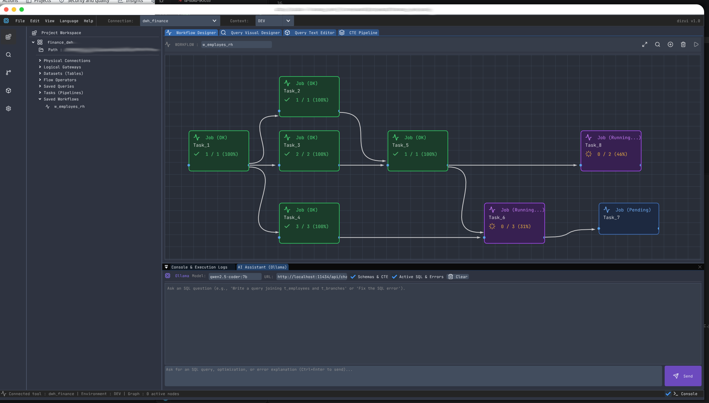
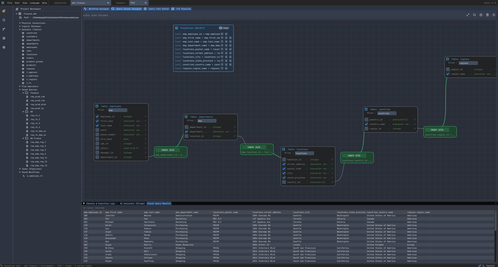
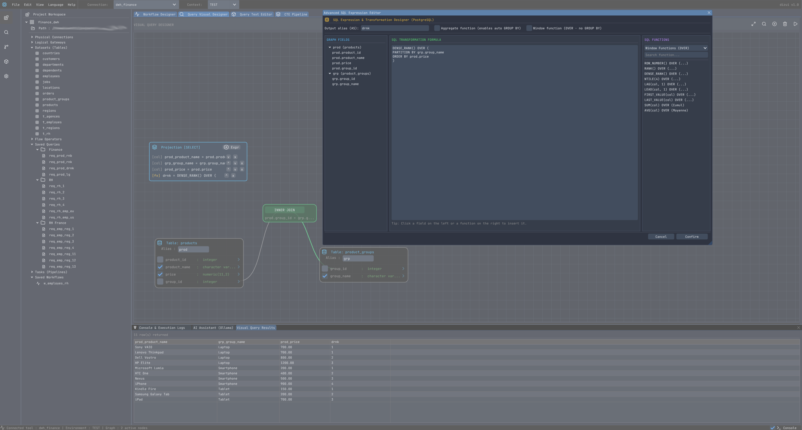

# dizui Studio

**dizui Studio** is a high-performance desktop data integration IDE, visual SQL query builder, and PostgreSQL pipeline orchestrator built with modern **C++23** and **Dear ImGui**.

---

## 📸 Screenshots

### Parallel DAG Workflow Execution & AI Assistant
Orchestrate dependent ETL jobs with live step-by-step progress tracking, color-coded node statuses (`Pending`, `Running`, `OK`, `Failed`), and an integrated local Ollama AI assistant.



---

### Visual Query Designer, Logical Folders & Live Results
Build multi-table joins visually, organize saved queries into logical folders (*Finance*, *HR*, *Others*), and inspect query results in real time.



---

### SQL Expression & Window Function Editor
Author custom expressions and PostgreSQL window functions (`ROW_NUMBER() OVER (...)`) using a categorized, searchable function catalog.



---

## ✨ Key Features

### 🔌 Environment & Connection Management
* **Physical & Logical Gateways:** Decouple physical PostgreSQL cluster credentials from logical environment gateways (`DEV`, `TEST`, `PROD`) for seamless pipeline promotion.
* **Database Reverse Engineering:** Browse schemas, filter tables, inspect column metadata (types, nullability, primary keys), and bulk-import multiple datasets into your project in one click.
* **Logical Query Folders:** Organize saved SQL queries into virtual folders (e.g., *Finance*, *HR*) via drag-and-drop or context menus without altering SQL identifiers or CTE dependencies.

### 🎨 Visual SQL Query Designer
* **Node-Based Graph Canvas:** Build complex queries visually using interactive table nodes, CTE nodes, `INNER`/`LEFT`/`RIGHT`/`FULL` joins, and `UNION`/`INTERSECT`/`EXCEPT` set operations.
* **Unified Projection & Expressions:** Add custom calculated columns, aggregates (`SUM`, `COUNT`, `AVG`), and **Window Functions** (`ROW_NUMBER() OVER (...)`, `RANK`, `LAG`, `LEAD`) with automatic `GROUP BY` exclusion.
* **Categorized PostgreSQL Function Catalog:** Searchable palette covering Logical, Comparison, Conditional, Mathematical, String, Pattern Matching, Data Type Formatting, Date/Time, JSON/JSONB, XML, Array, Full-Text Search, Aggregate, Window, Subquery, and Merge Support functions.
* **Live SQL Preview & Formatting:** Inspect, format, and synchronize generated SQL queries in real time with a live tabular result viewer.

### ⚙️ Tasks & Parallel Workflow Orchestration
* **Multi-Step ETL Tasks:** Chain sequential SQL operations (`SELECT`, `INSERT`, `CTAS`, `UPDATE`, `DELETE`, `DROP`) into reusable tasks.
* **Parallel DAG Workflows:** Orchestrate dependent jobs on a visual workflow canvas with real-time step-by-step progress tracking, status badges, and execution console logs.

### 🤖 Local AI Assistant & Localization
* **Ollama Integration:** Built-in local AI assistant for SQL generation, optimization, and troubleshooting without sending schema data to external cloud APIs.
* **Bilingual UI:** Instant runtime switching between **English** and **French** (`assets/locales/`).

---

## ⌨️ Keyboard Shortcuts

| Shortcut | Action | Context |
| :--- | :--- | :--- |
| `Ctrl + Shift + F` | Format SQL query in the text editor | Global / Edit Menu |
| `Ctrl + Shift + C` | Copy compiled visual SQL to system clipboard | Global / Edit Menu |
| `Ctrl + Shift + S` | Sync compiled visual graph into the SQL text editor | Global / Edit Menu |
| `Ctrl + Enter` | Send prompt to the local Ollama AI assistant | AI Assistant Panel |
| `Double-Click` | Open saved query, task, or workflow in active designer | Project Explorer |
| `Delete` | Remove selected node or link | Visual Query / Workflow Canvas |
| `Ctrl + Q` | Quit **dizui Studio** | Global / File Menu |

---

## 🛠️ Tech Stack

* **Language:** C++23
* **UI & Node Graph:** [Dear ImGui](https://github.com), [imgui-node-editor](https://github.com), GLFW, OpenGL 3
* **SQL & Data Engine:** `cppsqlx` & `libpq` (PostgreSQL)
* **Serialization & Icons:** `nlohmann/json`, Lucide Icons

---

## 🚀 Building from Source

### Prerequisites
* A C++23 compliant compiler (`GCC 13+` or `Clang 16+`)
* `CMake 3.20+` and `Ninja`
* PostgreSQL client development libraries (`libpq-dev` / `libpq-devel`)
* OpenGL & GLFW dependencies
* Installed `cppsqlx` library

### Build Instructions

```bash
# Configure the project
cmake -B build -G Ninja -DCMAKE_BUILD_TYPE=Release

# Compile and synchronize assets
ninja -C build

# Run dizui Studio
./build/dizui
```

---

## 📁 Project Structure

```text
dizui/
├── assets/
│   ├── fonts/               # UI fonts and Lucide icon font
│   └── locales/             # Bilingual JSON translation files (en.json, fr.json)
├── docs/
│   └── screenshots/         # Documentation images
├── include/                 # Application headers (Application, AboutModal, SqlFunctionsCatalog)
├── src/                     # Core UI, Query Designer, Workflow Engine, and Persistence
└── CMakeLists.txt           # Build configuration and asset synchronization
```

---

## 📄 License

This project is licensed under the MIT License. See the `LICENSE` file for details.
